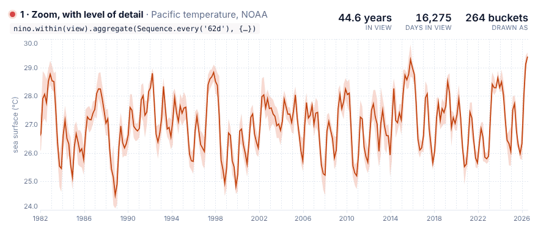
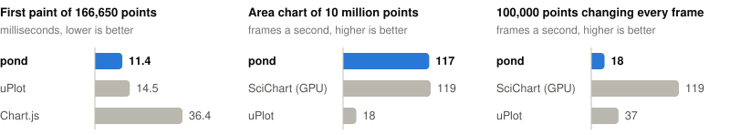
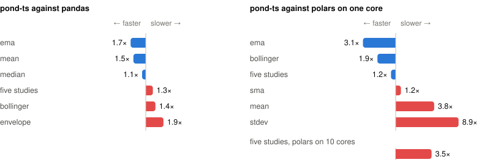
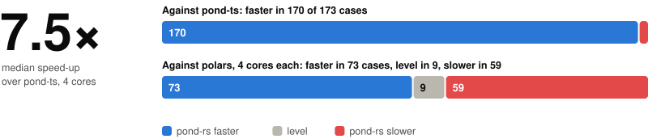

# pond

[](https://www.npmjs.com/package/pond-ts)
[](https://crates.io/crates/pond-rs)
[](https://pypi.org/project/pond-timeseries/)
[](https://github.com/pond-ts/pond/actions/workflows/ci.yml)
[](https://github.com/pond-ts/pond/blob/main/LICENSE)
[](https://pond-ts.org)

**Time series you can trust, from a batch of history to a live stream to the chart on screen.**

pond is for data that is a list of readings over time: server metrics, prices,
sensor and meter readings, heart rate on a run. You describe your columns once,
then ask the questions you actually have: the average per minute, a rolling
five-minute window, the same thing per host, one row per calendar day in New
York (including the 23-hour day when the clocks change), which readings are
out of the ordinary. The same operations work on a fixed batch of history and
on a live stream that keeps itself up to date as events arrive, and the chart
package draws the results directly, with no conversion step.

It is written in TypeScript, fully typed, and has a Rust twin, **pond-rs**,
that gives the same answers bit for bit and can be used from Rust, from
JavaScript (as WebAssembly) and from Python. pond-ts is the from-scratch
successor to [pondjs](https://github.com/esnet/pond).

<p align="center">
  
</p>

<sub>The real library on real data: 16,275 days of sea-surface temperature in
the Niño 3.4 region of the Pacific (NOAA OISST v2.1), the record that defines
El Niño. Every frame is recomputed by pond, using the call shown at the top of
the card: `within` plus `aggregate` to keep the zoom at about one bucket per
few pixels, `rolling` for the moving window, and `aggregate(Sequence.every(…))`
for the bars, drawn by `@pond-ts/charts`. Source and recorder:
[`docs/readme/demo/`](docs/readme/demo/).</sub>

## Why pond

### The series goes straight to the chart

`@pond-ts/charts` takes a `TimeSeries` or a `LiveSeries` as it is. You do the
maths in pond and hand the result to a chart layer. There is no step where you
reshape it into arrays of points, and a chart prop that names a column is
checked against your schema, so a misspelt column name is a compile error.

It stays quick on large data. A line of one million points pans at about 90
frames a second with nothing to configure, and an area chart of 10 million
points holds 117 frames a second
([how it works and where it stops](https://pond-ts.org/docs/how-to-guides/rendering-large-series);
figures under [Performance](#performance)).

### It is built for data that arrives over time

Readings go missing, arrive late, come from many machines at once, and need
grouping into calendar days that are not always 24 hours long. pond has a
stated rule for each, and you pick it with one argument:

- **Missing readings.** `fill` takes a strategy per column (hold the last
  value, draw a straight line, use zero) and the longest gap it is allowed to
  fill. `align` puts uneven readings onto a regular grid and does not draw a
  line across a reading that is missing.
- **Late and out-of-order events.** A `LiveSeries` rejects them, drops them,
  or sorts them into place if they arrive within a grace period you set.
- **Many sources at once.** After `partitionBy('host')`, every rolling window,
  fill and bucket is kept separately for each host.
- **Calendar time.** `Sequence.calendar('day', { timeZone: 'America/New_York' })`
  gives real local days, including the 23-hour day when the clocks go forward.
- **Types.** You describe the columns once. Every result knows its own
  columns, and `event.get('cpu')` is a `number | undefined` with no casts.

### The same answers in TypeScript, Rust and Python

pond-rs is the same library written in Rust. Its test suite runs every
operation against output written by pond-ts and requires the results to match
to the last bit. So you can try an idea in the browser, then run it over years
of data from Rust or Python, and get the same numbers.

## What's in this repository

**TypeScript packages** (npm, all released together under one version):

| Package                                                                  | What it's for                                                                                                                                               | Folder               |
| ------------------------------------------------------------------------ | ----------------------------------------------------------------------------------------------------------------------------------------------------------- | -------------------- |
| [`pond-ts`](https://www.npmjs.com/package/pond-ts)                       | The core. `TimeSeries` for data you have, `LiveSeries` for data still arriving, one set of operations for both. Runs in Node or the browser.                | `packages/core`      |
| [`@pond-ts/charts`](https://www.npmjs.com/package/@pond-ts/charts)       | React charts drawn on canvas that take a pond series as-is: line, area, band, bar, scatter, box, candlestick, heat map; cursors, selection, pan and zoom.   | `packages/charts`    |
| [`@pond-ts/react`](https://www.npmjs.com/package/@pond-ts/react)         | React hooks that hold a live series in a component and re-render it at a steady pace however fast events arrive.                                            | `packages/react`     |
| [`@pond-ts/financial`](https://www.npmjs.com/package/@pond-ts/financial) | 109 technical studies (moving averages, RSI, MACD, Bollinger, VWAP, Ichimoku, …), each checked against a pandas / TA-Lib reference, plus trading calendars. | `packages/financial` |
| [`@pond-ts/fit`](https://www.npmjs.com/package/@pond-ts/fit)             | Activity data: reads FIT / GPX / TCX files; distance, elevation, power, heart-rate zones, splits.                                                           | `packages/fit`       |
| [`@pond-ts/process`](https://www.npmjs.com/package/@pond-ts/process)     | **Experimental.** A whole calculation written down as data (JSON), so a program or an AI model can build one, run it, and cache the result.                 | `packages/process`   |

**pond-rs, the Rust version** — same operations, same results as pond-ts (a
test suite checks every operation against output written by pond-ts):

| Package                                                               | What it's for                                                                                                     | Folder           |
| --------------------------------------------------------------------- | ----------------------------------------------------------------------------------------------------------------- | ---------------- |
| [`pond-rs`](https://crates.io/crates/pond-rs) (crates.io)             | The Rust library: batch and live series, all 109 studies, Arrow files in and out, work spread over several cores. | `crates/pond-rs` |
| [`@pond-ts/wasm`](https://www.npmjs.com/package/@pond-ts/wasm)        | pond-rs compiled to WebAssembly for Node and browsers, called with pond-ts's method names.                        | `packages/rs`    |
| [`pond-timeseries`](https://pypi.org/project/pond-timeseries/) (PyPI) | pond-rs from Python. pandas, polars and pyarrow tables go in and come back out.                                   | `crates/pond-py` |

**Also here:** the docs site [pond-ts.org](https://pond-ts.org) (`website/`), a
Claude Code plugin with skills for using pond (`plugins/pond-ts`), worked
example apps (`apps/`: a live chart drawn off the main thread, and a demo of
`@pond-ts/process`), and the roadmap and design notes ([PLAN.md](PLAN.md),
`docs/`).

```sh
npm install pond-ts                                   # core: enough for Node pipelines and non-React apps
npm install @pond-ts/charts @pond-ts/react pond-ts    # add the React chart stack
cargo add pond-rs                                     # Rust
pip install pond-timeseries                           # Python
```

### Which one to use

- **An app in the browser or in Node, with charts:** `pond-ts`, plus
  `@pond-ts/charts` and `@pond-ts/react`. Everything is typed and the charts
  read the series directly.
- **Heavy computation in Rust or Python:** `pond-rs`. It is several times
  faster and can use several cores.
- **The Rust engine from JavaScript:** `@pond-ts/wasm` is 3–11× faster than
  pond-ts on the financial studies, on one thread. It is younger than the
  rest: it has no TypeScript types yet, you release each series yourself with
  `free()`, it needs Node 20.19 or newer, and the charts do not take its
  series directly. Pass results to pond-ts as JSON or Arrow
  ([details](https://pond-ts.org/docs/javascript/)).

## Quick start

### A batch of history

```ts
import { Sequence, TimeSeries } from 'pond-ts';

const schema = [
  { name: 'time', kind: 'time' },
  { name: 'cpu', kind: 'number' },
  { name: 'requests', kind: 'number' },
  { name: 'host', kind: 'string' },
] as const;

const cpu = TimeSeries.fromJSON({
  name: 'cpu',
  schema,
  rows: [
    ['2025-01-01T00:00:00Z', 0.31, 120, 'host1'],
    ['2025-01-01T00:01:00Z', 0.44, 135, 'host2'],
    ['2025-01-01T00:02:00Z', 0.52, 141, 'host1'],
    ['2025-01-01T00:03:00Z', 0.48, 128, 'host1'],
    ['2025-01-01T00:04:00Z', 0.63, 166, 'host3'],
  ],
});

// Average CPU and total requests per minute.
const byMinute = cpu.aggregate(Sequence.every('1m'), {
  cpu: 'avg',
  requests: 'sum',
});

// One row per calendar day in New York, clock changes included.
const byDay = cpu.aggregate(
  Sequence.calendar('day', { timeZone: 'America/New_York' }),
  { cpu: 'max' },
);

// A rolling two-minute average with a band two standard deviations wide.
const bands = cpu.baseline('cpu', { window: '2m', sigma: 2 });

// Only the readings that fall outside that band.
const unusual = cpu.outliers('cpu', { window: '2m', sigma: 2 });

// The same kind of rolling window, kept separately for each host.
const perHost = cpu
  .partitionBy('host')
  .rolling('5m', {
    avg: { from: 'cpu', using: 'avg' },
    sd: { from: 'cpu', using: 'stdev' },
  })
  .collect();
```

Every operation takes a series and returns a new one; the original is never
changed. The rest of the batch operations (`align`, `smooth`, `join`, `fill`,
`dedupe`, `diff`, `rate`, `pivotByGroup`, and more) work the same way.

### On the chart

```tsx
import {
  BandChart,
  ChartContainer,
  ChartRow,
  CrosshairCursor,
  Layers,
  LineChart,
  YAxis,
} from '@pond-ts/charts';

// `bands` is the series from the batch example: cpu plus avg, sd, upper, lower.
export function CpuChart() {
  return (
    <ChartContainer width="auto" panZoom>
      <CrosshairCursor />
      <ChartRow height={240}>
        <YAxis id="cpu" format=".0%" />
        <Layers>
          <BandChart series={bands} lower="lower" upper="upper" axis="cpu" />
          <LineChart series={bands} column="cpu" axis="cpu" />
        </Layers>
      </ChartRow>
    </ChartContainer>
  );
}
```

Rows in one container share a time axis, so they pan, zoom and track the
cursor together. Line, area, band, bar, scatter, box, candlestick and heat map
layers are included, along with cursors, selection, draggable annotations and
a time axis that skips the hours a market is closed. Live data goes through
the same layers: hold the series with `useLiveSeries` from `@pond-ts/react`
and pass its snapshot as `series`.

### A live stream

```ts
import { LiveSeries } from 'pond-ts';

const live = new LiveSeries({
  name: 'cpu',
  schema,
  retention: { maxAge: '10m' }, // keep the last ten minutes
  ordering: 'reorder', // accept events that arrive out of order...
  graceWindow: '5s', // ...up to five seconds late
});

live.push([Date.now(), 0.45, 128, 'api-1']);

// Updated as each event arrives; nothing is recomputed from scratch.
const recent = live.rolling('5m', { cpu: 'avg' });
recent.on('event', (e) => console.log(e.get('cpu')));

// Per-host average and spread, using every tenth event to bound memory.
const liveHosts = live
  .partitionBy('host')
  .sample({ stride: 10 })
  .rolling('5m', {
    avg: { from: 'cpu', using: 'avg' },
    sd: { from: 'cpu', using: 'stdev' },
  });

// A plain TimeSeries of what is in the buffer right now.
const snapshot = live.toTimeSeries();
```

`filter`, `map`, `aggregate`, `rolling`, `diff`, `rate`, `fill`, `cumulative`,
`sample` and `reduce` exist on both `TimeSeries` and `LiveSeries`. On a live
series they update as events arrive, and the retention setting keeps memory
bounded.

### Also in the core

- **Triggers** decide how often a live rolling window reports: on every
  event, on clock boundaries, at a fixed interval, or every N events.
- **Typed columns.** `series.column('cpu')` gives `min`, `max`, `sum`, `mean`,
  `stdev`, `median` and `percentile` directly, and `toFloat64Array()` hands
  the numbers to a canvas or WebGL draw loop without copying them.
- **Arrow in and out.** `fromArrow` and `toArrow` exchange columns with Apache
  Arrow without copying the numeric data.
- **Series on another axis.** `ValueSeries` is keyed by a value that only
  increases, such as distance along a route, instead of by time.
- **Sampling for display.** `series.sample({ reservoir: { size: 500 } })`
  draws 500 points evenly at random from a series of any length.

## Performance

Three things were measured, each on its own: drawing, the TypeScript library,
and the Rust library. The dates and machines differ, so the ratios do not
multiply together. Blue is pond. In the second and third figures, red is
where pond is slower.

### Charts

<picture>
  <source media="(prefers-color-scheme: dark)" srcset="docs/readme/perf/perf-charts-dark.svg">
  
</picture>

<sub>Apple M1 Pro, headless Chromium.
[First paint](website/docs/reference/charts-benchmarks.mdx),
[scaling](website/docs/reference/charts-scale-benchmarks.mdx). Also behind:
hovering costs more than in uPlot, and the charts add 50 KB compressed on top
of React and pond-ts.</sub>

### pond-ts

<picture>
  <source media="(prefers-color-scheme: dark)" srcset="docs/readme/perf/perf-pond-ts-dark.svg">
  
</picture>

<sub>The same query on 500,000 rows. Node 22, Apple silicon, 30 July 2026.
[Every figure, losses included](website/docs/reference/benchmarks.mdx).</sub>

- **Against pondjs:** faster on all 54 operations the two share, 20.7× by
  geometric mean.
- **Loading rows** is where pond-ts is furthest behind: 6.3 ms for 500,000
  rows against 0.03 ms for polars, because it checks every row against the
  schema as it loads.
- **One thread.** An opt-in worker mode for Node
  (`@pond-ts/financial/parallel`) speeds up three of the rolling studies, and
  pond-rs is the answer when you need every core.
- **Live:** about 350,000 events a second pushed one at a time into a series
  that keeps a rolling average and one-minute buckets, and about a million a
  second in batches of 1,000
  ([one thread, 4-core Xeon, 31 October 2026](website/docs/rust/performance.mdx#from-javascript)).

### pond-rs

<picture>
  <source media="(prefers-color-scheme: dark)" srcset="docs/readme/perf/perf-pond-rs-dark.svg">
  
</picture>

<sub>22 October 2026.
[Full comparison](crates/pond-rs/bench/COMPARISON.md).</sub>

- **Against polars** it is furthest ahead on rolling "top 3" and "unique
  values" windows and on joins that keep every row. It is furthest behind
  where a rule is written as a function that pond calls once per row
  (`filter`, `collapse`). Write the rule as a column expression where you
  can, and it runs over whole columns instead.
- **From JavaScript,** `@pond-ts/wasm` runs the same engine as WebAssembly on
  one thread: 3–11× faster than pond-ts on the financial studies and 1.4–5.5×
  on live series. Write filters as expressions (`col('v').gt(0)`); a filter
  written as a JavaScript function is about 18× slower than in pond-ts
  ([table](website/docs/rust/performance.mdx#from-javascript)).

The figures are drawn by
[`docs/readme/perf/make-charts.mjs`](docs/readme/perf/make-charts.mjs) from
the numbers on the linked pages. To run the pondjs comparison yourself:

```sh
npm run build && node packages/core/bench/vs-pondjs.cjs
```

## Documentation

The full guide is at **<https://pond-ts.org/>**.

- **[Start here](https://pond-ts.org/docs/)**: a walkthrough of batch, live
  and React examples.
- **[Concepts](https://pond-ts.org/docs/concepts/)**: time keys,
  sequences, windows, partitions, triggers and late data.
- **[Coming from pondjs](https://pond-ts.org/docs/concepts/mental-model#coming-from-pondjs)**:
  what each pondjs idea became.
- **[Batch operations](https://pond-ts.org/docs/series/queries)**
  and **[live series](https://pond-ts.org/docs/live/live-series)**.
- **[Charts](https://pond-ts.org/docs/charts)** and the
  **[chart gallery](https://pond-ts.org/docs/charts/gallery)**.
- **[pond-rs](https://pond-ts.org/docs/rust/)**: Rust, WebAssembly and
  Python.
- **[How-to guides](https://pond-ts.org/docs/how-to-guides)**: building a
  dashboard, cleaning messy data, drawing very large series.
- **[API reference](https://pond-ts.org/generated-api/core/)**: every public
  class and method, generated from the source.
- **[CHANGELOG](./CHANGELOG.md)**: what shipped in each release.

## Versioning

All seven npm packages (the six above plus `@pond-ts/wasm`, pond-rs compiled
to WebAssembly) release together under one version — keep them in step.

- **Today (0.x):** a minor release may contain breaking changes; each is
  marked **breaking** in the [CHANGELOG](./CHANGELOG.md) with a migration
  note. Patch releases never break.
- **From 1.0:** [semver](https://semver.org/) — breaking changes only in a
  major release.
- **Public API:** the exports of each package's entry points, mapped in
  [API.md](API.md). Anything marked experimental (including all of
  `@pond-ts/process`) or internal is excluded.

Details: [pond-ts.org/docs/reference/versioning](https://pond-ts.org/docs/reference/versioning).

## For coding agents

pond is built by agents and expects to be used by them. Three things exist so
an agent can go from "never heard of pond" to working code without a human in
the loop:

- **`AGENTS.md` and `API.md` ship inside each of the six TypeScript
  packages.** `node_modules/pond-ts/AGENTS.md` is a one-read guide: which
  package for which task, the idioms, and the mistakes agents make. `API.md`
  maps every public export to its source file. Sources:
  [docs/agents/USING_POND.md](docs/agents/USING_POND.md), [API.md](API.md).
- **<https://pond-ts.org/llms.txt>** lists every docs page with a one-line
  description, and `llms-<area>.txt` gives each package's docs in a single
  fetch.
- **A Claude Code plugin** with skills for the core, the charts and the
  financial package, versioned with the library:
  ```
  /plugin marketplace add pond-ts/pond
  /plugin install pond-ts@pond-ts
  ```

## Examples

- **[pond-ts-dashboard](https://github.com/pjm17971/pond-ts-dashboard)**: a
  React dashboard that streams per-host CPU and request metrics, keeps a
  rolling baseline for each host, flags readings outside it, and draws
  everything as live line and bar charts. Walked through in
  [Building a dashboard](website/docs/how-to-guides/dashboard-guide.mdx).
- **[`apps/worker-chart`](apps/worker-chart)**: a live chart drawn off the
  main thread.
- **[`apps/process-demo`](apps/process-demo)**: a demo of `@pond-ts/process`.
- **[`docs/readme/demo`](docs/readme/demo/)**: the source of the animation at
  the top of this page.

## Develop

The six TypeScript packages live under `packages/` as npm workspaces (`core`
is `pond-ts`; the rest match their scoped names). The Rust crates live under
`crates/` as a Cargo workspace, and `packages/rs` is built from them. The docs
site in `website/` has its own `package.json` and is not a workspace.

Node 18 or newer runs the TypeScript packages; `@pond-ts/wasm` needs 20.19, and
the docs site (Docusaurus) needs 20.

```sh
npm install         # once; installs dependencies for all six packages
npm run build       # build all six TypeScript packages
npm test            # runtime and type-level tests
npm run format      # prettier across the repo
npm run verify      # format check, build and test, as CI runs them
cargo test          # the Rust crates
```

## License

MIT
